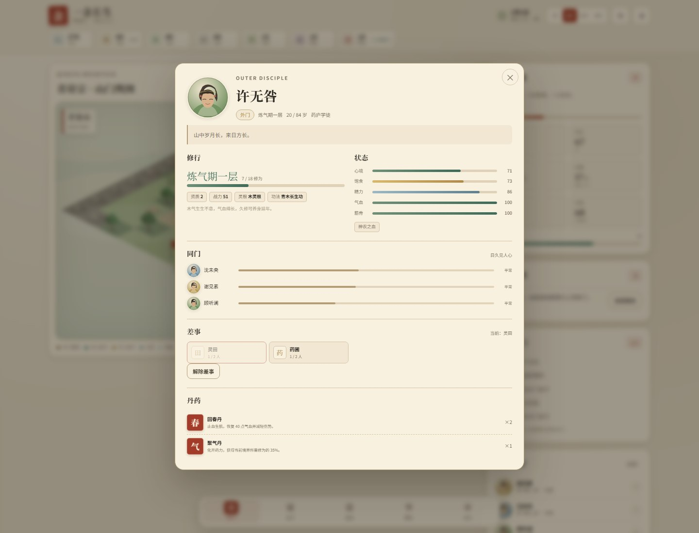

# 一念长生 · 宗门篇

> 从三间茅屋，到一座仙门。

## 2.3.7 · 青绿山门（2026-11-16）

- **山门页收束**：撤下舆图与绘卷，山门页改为「宗门气象 + 当前要务 + 长卷 / 委托」的面板总览；建筑与弟子从下方页签查看。
- **青绿主视觉**：开场、创建页与山门横卷换成本机 ComfyUI + SDXL 生成的青绿山水；桌面 16:9、手机竖幅各一张。

以下经营功能沿用已有版本：

- **坊市扩容**：粮食、木材、石料、灵草与五种丹药都可买入卖出；每种货物都支持输入自定义数量，也保留「购 1 / 购 5 / 卖 5」快捷按钮。丹药按原价五成回收。
- **掌门固定身份**：掌门就是掌门，不再额外显示“内门”身份；和普通弟子一样可以领差事、随队历练。掌门阵亡后山门暂停，必须从弟子中手动另立掌门才能继续。
- **弟子状态简化**：弟子卡片不再显示心境、饱食、精力进度条；详情只保留气血与筋骨。底层饥饿、精力与心情仍会影响修行，只是不再堆在界面上。
- **事务红点清理**：底部「事务」不再显示没有实际事件的数字红点。
- **山水画面**：原创青绿山水插画用于开场与卷首，松绿与淡金重整界面；插画随项目打包，不需要外部图片服务。
- **宗门长卷**：七章目标从「初燃炉火」走到「一念长生」。条件、进度和奖励均可查看，点目标可前往对应页面；完成前章才能领取后章，每章仅领一次。
- **四时委托**：春山采药、长夏施粥、秋收修桥、寒夜送暖。卡片明确展示交付物资与回礼，每个游戏季节结算一次，过期后自动换单，资源不足不扣费。
- **保留旧进度**：继续使用 v3 存档主键和既有备份、v2 迁移流程。新增长卷记录自动补齐，已有进度按实际条件计算，无需重开。

开场与卷首山水由本机 ComfyUI + SDXL 生成；提示词与工作流见 `assets/art-direction.md`。建筑详情中的小景继续使用 SVG 绘制。

一款适配手机的原创宗门修仙模拟游戏。你带着半卷残经与几名弟子，在青崖山重新立下山门：安排外门弟子种田烧饭，让内门弟子吐纳修行；修屋、布局、炼丹、参研、历练，等一个山门钟声响彻天下的日子。

> **在线试玩**：<https://hhanvi.github.io/yinian-changsheng/>
>
> 直接打开即可开始，手机浏览器也能玩。无需安装、无需构建。

<details>
<summary>展开看看建筑营造图与一键补位</summary>
<p align="center"></p>
</details>

## 既有宗门经营系统

旧版是一个人的文字修仙。新版把视角放大到一整座山门：

- **山门总览**：宗门气象、当前要务、长卷与四时委托集中在山门页，打开就能看到山门近况，不再被舆图占据视线。
- **营造自动择地**：在「营造」里选好图样，山门会依山势、路径和相邻建筑自动找一块空地开工，不再需要手动点地块。
- **差事一步到位**：弟子卡片和详情里直接选差事，或点「自动安排」；建筑详情可「一键补位」。安排时时间自动暂停，选完继续。
- **建筑营造图**：每座建筑都有一幅随类型与等级自动生成的手卷小景，山岛、松林、瀑布与灯影各不相同；它只是画，不可点击。
- **事件不再连番打扰**：山门事件之间有冷却，弹窗频率明显降低；重要事件仍会暂停时间等你选择。
- **差事自动补位**：弟子历练归来、空闲或晋升后，会按身份、灵根、特质与建筑空缺自动挑选最合适的差事；想固定某人，再手动改一次即可，之后不会被自动安排覆盖。
- **常驻历练**：选好地点和队伍，打开「常驻历练」，队伍归来休整两日后会自动再出发，直到你叫停；归来不再弹报告，只在纪要里留一笔。
- **存档更稳**：每日自动存档，切到后台或离开页面时补存；主存档损坏会回退到上一份备份，旧页面也不会覆盖新进度。
- **多弟子与内门外门**：外门弟子负责灵田、药圃、膳堂等劳作；内门弟子专注修炼，也可守丹房、藏经阁与演武场。外门修到炼气三层，可花灵石晋升内门。
- **需求与状态**：弟子卡片不再显示心境、饱食、精力，详情只保留气血与筋骨。床位不足、饥饿、疲惫和受伤仍会在后台拖慢修行；膳堂、灵井、祠堂、观景亭与好风水能让日子好过些。
- **建造与风水**：静室、弟子居、灵田、药圃、丹房、藏经阁、聚灵阵、药庐、客舍、库房、演武场、观景亭……建筑相邻会形成风水加成，灵气与风水共同影响修炼和突破。
- **四时与生产**：春种秋收，冬天灵田近乎绝收；膳堂有人当值可减少粮食消耗。仓里没粮，弟子真的会饿倒。
- **修行与破境**：炼气、筑基、金丹、元婴、化神、炼虚、合体、大乘、渡劫，直至飞升。修为够了会自动尝试破境，也可手动助其突破、服用破境丹。
- **丹房与藏经阁**：灵草炼成回春、聚气、破境、凝神、洗髓丹；藏经阁产出悟道，用于参研灵植术、丹道、阵法、剑心、养神、天机、大衍道典。
- **山下历练**：青崖后山、落霞山、云梦泽、万妖岭、九幽墟。派弟子下山，带回灵石、灵草、丹药与声望，也可能带伤回来。
- **山门事件**：流民叩山、灵雨入山、妖兽夜袭、散修借宿、同门争执、黑风索贡、血刀门寻仇、魔潮围山、仙门大比……每个选择都会留下痕迹。
- **弟子关系与功法**：每个弟子有出身、灵根、资质、特质、功法和同门关系。知己与不和都会影响日常修行。
- **宗门品阶**：从荒山小门、三流、二流、一流、天下名门，到仙道圣地。声望越高，山门越热闹。
- **两种纸色**：宣纸与夜色，随时切换。桌面端与手机端都有完整布局。

## 怎么玩

1. **先让山门转起来**：开局三名外门弟子已在灵田、药圃、膳堂当值，掌门也在山中，可以自由安排差事。山门页是面板总览，建筑与弟子请从下方页签查看。
2. **补床位、修静室**：弟子多了，弟子居会不够住；内门弟子多了，静室会不够坐。去「营造」选建筑，山门会自动择地开工。
3. **看季节囤粮**：灵田与药圃受季节影响。冬天前多存粮，或者去「坊市」买粮。
4. **安排差事**：在弟子卡片或详情里直接选差事，也可以点「自动安排」。外门做粗活，内门修炼或守丹房、藏经阁、演武场；安排时时间会自动暂停。
5. **派人下山**：在「事务 · 历练」选择地点和弟子。危险地点需要内门弟子与足够战力。想省事就打开「常驻历练」，队伍会自行往返，直到你叫停。
6. **炼丹与参研**：丹房把灵草炼成丹药；藏经阁产出悟道。参研能解锁聚灵阵、丹方与宗门加成。
7. **应对事件**：事件之间有冷却，不会连日弹窗。事件发生时时间会暂停，选择会改变资源、声望，甚至触发战斗。
8. **提升声望**：历练、事件、祠堂与宗门建设都会带来声望。声望决定宗门品阶。
9. **培养内门**：外门弟子修到炼气三层后可晋升内门。内门弟子修为够了会自动破境；也可以手动助其突破。
10. **目标**：让宗门晋为仙道圣地，并培养出一位飞升真仙。掌门若遭遇不测，山门会暂停，需从弟子中手动另立掌门；若无人可继，宗门传承便断了。

### 时间与速度

- 游戏按“日”推进。右上角可暂停，或切换 1× / 2× / 4×。
- 手机端右上角有暂停与速度切换按钮。
- 事件、战斗报告、历练报告会自动暂停时间。
- 页面切到后台时会自动暂停。

### 存档

- 每天自动保存在浏览器 `localStorage`，主键为 `yinian_sect_save_v3`，并保留一份 `yinian_sect_save_v3_backup` 备份。
- 切到后台或离开页面时会补存一次；主存档损坏时会自动读取备份。
- 首次打开新版会自动读取并迁移 `yinian_sect_save_v2` 旧档；迁移后写入 v3。旧缓存页面只会写 v2，不会再覆盖 v3 进度。
- 同一浏览器开多个页面时，旧页面不会覆盖较新的进度；若另一页写入了新存档，当前页会暂停并提示刷新。
- 设置里可以立即存档、导出 JSON、导入存档。
- **旧版 v1 存档不兼容**；新版使用独立存档键，不会覆盖旧档。
- 清除网站数据会连同备份一起失去，重要进度请导出。

## 本地运行

```bash
npm start
# http://127.0.0.1:8788
```

也可以直接双击 `index.html`，或使用任意静态服务器：

```bash
python -m http.server 8788
```

部署到 GitHub Pages、Vercel、Netlify 等静态托管时不需要构建步骤。

## 测试

```bash
npm test
```

当前共 54 项 Node 测试：41 项引擎测试与 13 项成长系统测试。覆盖生产、修行、建筑、历练、存档、坊市丹药买卖与自定义数量、掌门领差事与历练、掌门差事读档保留、手动继任，以及章节解锁、领奖防重、旧档记录、四季交付、跨年换季、资源原子扣款和七章贯通。

## 项目结构

```text
index.html              页面外壳
manifest.webmanifest    PWA 清单
server.js               零依赖静态服务器
css/style.css           全部样式：宣纸/夜色、响应式、动效
css/art.css             青绿山水视觉、长卷与委托样式
js/data.js              境界、灵根、出身、特质、功法、建筑、丹药、参研、历练
js/events.js            山门事件与选项
js/engine.js            纯逻辑模拟引擎（可 Node 测试）
js/progression.js       七章宗门长卷、四时委托与奖励纯逻辑
js/ui.js                界面、建筑与人物绘制、弹窗
js/main.js              启动
tests/engine.test.js    Node 引擎测试
tests/progression.test.js  成长、交付、存档兼容与边界测试
assets/                 图标、PWA 图标、截图
```

## 设计说明

- 玩法气质参考《了不起的修仙模拟器》等宗门经营 / 殖民地模拟作品，以及中文修仙题材的常见设定；**没有使用任何商业游戏的代码、图片、音频或文案素材**。
- 代码、界面、文案、内联 SVG 建筑与人物、图标与截图均为本项目原创。
- 本项目与《了不起的修仙模拟器》及其开发方无隶属关系。
- 无外部字体、无 CDN、无追踪脚本；所有资源均来自本站。

## 已知取舍

这是一个网页规模的宗门模拟，不是对某款商业游戏的完整复刻。当前版本重点做了“山门生活 + 弟子成长 + 资源与事件”的闭环；阵法战斗、器物炼制、宗门外交、更多地图与更复杂的关系网，留待后续版本。

---

如果玩得开心，欢迎在 GitHub 上点个 Star：<https://github.com/hhanvi/yinian-changsheng>
