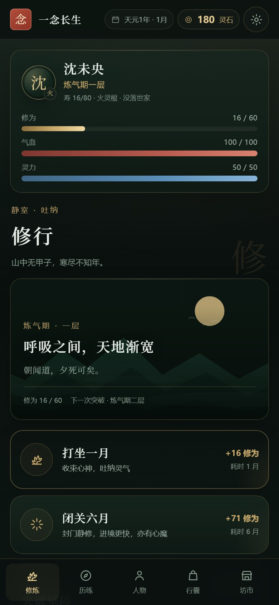

# 一念长生 · 文字修仙

> 一念起，万水千山。

一款原创的网页文字修仙游戏。无需安装、无需后端、无需联网，打开浏览器就能从炼气一层一路走到羽化飞升。界面针对手机竖屏做了完整适配，同时保留了桌面端的双栏布局。

<p align="center"></p>
<p align="center"></p>

## 玩法

- **打坐 / 闭关**：消耗游戏内时间积累修为。修为满后可以冲关突破；突破失败会损失修为，但会留下心得，提高下次成功率。
- **历练**：落霞山、云梦泽、万妖岭、九幽墟四片区域，41 个原创奇遇事件。事件包含属性检定、物品需求、交易、战斗与永久属性奖励。
- **战斗**：普通攻击、功法术法、服丹、遁走。敌人属性相对玩家当前境界生成，任何阶段都有来有回；战败不会删档，但会损失部分修为与灵石。
- **功法与法器**：8 门功法、13 件法器、3 个装备位。功法决定修炼速度与战斗术法，法器提供百分比属性。
- **坊市**：货物每三个月自动更新，也可花灵石刷新。境界越高，货架上的东西越好，价格也会水涨船高。
- **炼丹**：6 张丹方，材料来自历练。悟性与火灵根会提高成丹率，失败会炸炉。
- **境界**：炼气、筑基、金丹、元婴、化神、炼虚、合体、大乘、渡劫，最后渡过九霄雷劫飞升。突破会大幅提升属性与寿元。
- **成就 / 见闻录 / 轮回**：15 个成就；飞升或坐化后可以转世重修，轮回印记会保留少量悟性、气运与初始灵石。
- **本地存档**：自动保存在浏览器 localStorage，支持导出 / 导入 JSON 存档。

## 运行

### 方式一：直接打开

双击 `index.html` 即可游玩。游戏不依赖构建工具、ES Module 或网络请求。

### 方式二：本地服务器（推荐，便于安装 PWA）

```bash
npm start
# 打开 http://127.0.0.1:8788
```

或者：

```bash
python -m http.server 8788
```

也可以直接把整个目录部署到 GitHub Pages、Vercel、Netlify 或任意静态托管服务，无需构建。

### 测试

```bash
npm test
```

测试覆盖了数据引用完整性、角色属性、修炼与突破、事件结算、战斗胜负、坊市、炼丹、成就与存档往返，共 29 项。

## 手机适配

- 移动优先的底部导航（修炼 / 历练 / 人物 / 行囊 / 坊市），桌面端自动切换为左侧导航。
- 所有主要点击目标不小于 44px，输入框与按钮适配触摸。
- 使用 `100dvh`、`env(safe-area-inset-*)` 处理刘海屏与浏览器工具栏。
- 弹窗在手机上为底部抽屉，桌面上为居中对话框。
- 支持夜墨 / 宣纸两套主题，以及“减少动画”开关。
- 页面在 320px、360px、390px、平板与桌面宽度下均无横向滚动。

## 项目结构

```text
index.html              页面入口
manifest.webmanifest    PWA 清单
server.js               零依赖静态服务器
css/style.css           全部样式（双主题、响应式、动画）
js/data.js              世界观、境界、物品、功法、敌人、事件、丹方、成就
js/engine.js            纯逻辑引擎（属性、修炼、事件、战斗、坊市、炼丹、存档）
js/ui.js                界面渲染、弹窗、交互与流程
js/main.js              启动入口
tests/engine.test.js    Node 逻辑测试
assets/                 图标、PWA 图标与界面截图
```

## 设计说明

游戏玩法参考了以下开源项目中常见的文字修仙设计思路：

- [setube/vue-xiuxiangame](https://github.com/setube/vue-xiuxiangame) —— 文字修仙、境界、历练、坊市等玩法结构。
- [JeasonLoop/react-xiuxian-game](https://github.com/JeasonLoop/react-xiuxian-game) —— 境界层数、事件模板、装备与灵宠等系统组织方式。

本项目的代码、数值、事件文案、美术（CSS/SVG）均为原创实现，未复制上述项目的源码或素材。若你打算将本作用于商业用途，请自行确认参考项目的许可与素材版权。

## 说明

- 游戏内时间是“天元纪年”，每次打坐消耗 1 个月，闭关消耗 6 个月，历练消耗 1–3 个月。
- 寿元耗尽会坐化，进入结局界面；转世重修会保留轮回印记。
- 存档只存在当前浏览器。清理浏览器数据会丢失存档，建议在设置中定期导出。
